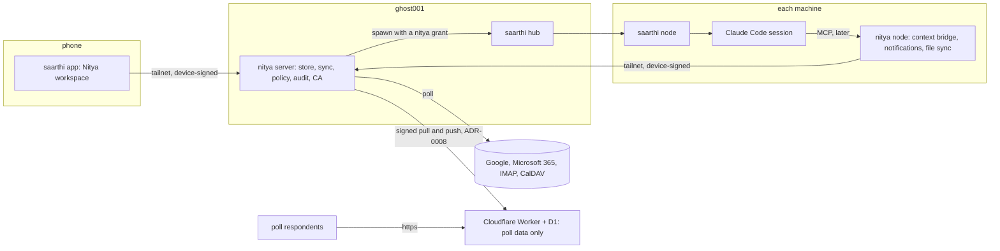

# nitya - one self-hosted server for the day-to-day of life: architecture

The design of the code for [[PRJ-0001]]. Decisions with their alternatives are recorded one
per file in `decisions/`; this document says how the pieces fit and links them. Drawn up
from the owner's interview on 2026-11-22/23 ([[AGS-20261123-bhdnxc]]); nothing is built
yet, and the experiments named below test what it rests on.

## Goals and constraints
- Replace, step by step, the user-activity tools in the owner's computing stack. Phase 1:
  calendars synced two-way with Google, Microsoft 365 and plain CalDAV; meeting polls
  answered by outside people; email read, searched and triaged from Google, Microsoft 365
  and plain IMAP; tasks tied to calendar and email; agents acting on all of it through
  approved plans; a node per machine for agent context, desktop notifications, and notes
  and files sync.
- Give agents, through saarthi, enough context to automate mundane tasks, under grants the
  owner controls (ADR-0004).
- Strong cryptography and auditable, role-based access: encryption at rest, per-user keys,
  mutual authentication per device, a signed audit log (ADR-0005, ADR-0006, ADR-0007).
- One user now; multiple accounts on the server by design (ADR-0001).
- Not now: finances, food and health, being a mail server (nitya is a client of mailboxes).
- Runs on ghost001 beside the saarthi hub; deployed by NixOS and home-manager modules from
  this repo's flake; one developer with agents; no deadline.

## Data model
- **Account**: one person on the server; owns everything below and its user key, in one
  key set of wraps that its devices read and write whole (ADR-0010, ADR-0013).
- **Device**: a node, an app install, or an agent job; an Ed25519 key and a short-lived
  certificate from the server, bound to its tailnet node id and got with a one-time
  enrollment code (ADR-0011); an X25519 wrap key, to which the account's user key is
  wrapped once an unlocked device approves it by fingerprint (ADR-0005, ADR-0013).
- **Channel**: one provider account and data class (a Google calendar list, an IMAP
  mailbox); a driver, an opaque cursor, a sync stage (ADR-0003), synced every minute
  while the owner consents to `tokens` and its class (ADR-0017).
- **Item**: an event (raw iCalendar), a message (raw MIME), a task; provider ids and etags;
  encrypted under its class's data key. The source of truth.
- **Index**: full text and later vectors over items; derived, versioned by generation,
  rebuildable.
- **Grant**: what an agent may do, as separate actions scoped to sources and time
  (ADR-0004, ADR-0006). **Plan**: a proposed set of writes, approved or not.
- **Poll**: a meeting poll with invitee and response capability tokens (after @rallly).
- **Audit entry**: append-only, hash-chained, signed, one chain per account, checked by
  its devices against their checkpoints (ADR-0007, ADR-0015).

## Components

- **nitya server** (ADR-0001): its own tsnet identity; the store, channel drivers and
  sync scheduler, the Cedar policy engine, the audit log, the device CA, the planner that
  holds agent plans for approval, and the saarthi control-service client that spawns
  sessions for nitya's jobs.
- **nitya node** (ADR-0001): its own tsnet identity; desktop notifications; notes and files
  sync; later an MCP server giving local agent sessions nitya's context under the
  machine's grants.
- **Nitya workspace** in saarthi's app (ADR-0002): calendar, mail, tasks, polls and plan
  approvals, talking to the server directly.
- **saarthi** is a peer, not a transport: nitya asks its hub to spawn sessions (ADR-0004).

## Stack
- Rust for the server and node, like saarthi (ADR-0001); saarthi's tailnet crate, copied
  as sandhi did; the API is gRPC with tonic, every call signed by the device (ADR-0011); one SQLite database as the store (ADR-0012); Cedar for policy, its schema and policies in `crates/server/policies` (ADR-0006, ADR-0014); age X25519 key wrapping and AEAD from
  RustCrypto (ADR-0005, ADR-0013); candidates to evaluate: pimalaya crates for mail (@himalaya),
  an iCalendar crate chosen by [[EXP-20261123-bhfzfs]].
- Nix flake for the dev shell, packages, NixOS module (server) and home-manager module
  (node), with module tests, as saarthi and sandhi do; secrets reach the server as agenix
  files passed as systemd credentials (ADR-0016).
- Provider OAuth apps as the `nitya-oauth` terranix stack (`nix/infra/`), on neusis's
  stack runner; secrets as agenix files in neusis (ADR-0009).

## Phases
Each phase is a `PHS` page linked from the project page's *Progress*.
- Phase 0, spikes and design: the four experiments below and this document. Done when each
  has an outcome and the decisions they touch are confirmed or superseded.
- Phase 1, core: server and node on tsnet, enrollment and device certificates, the key
  hierarchy, the audit log, Cedar policies; check: a node and the app enroll, a revoked
  device is refused, every request is in a verifiable chain.
- Phase 2, calendar sync and tasks: Google, Graph and CalDAV channels, two-way; tasks.
- Phase 3, email: read, search, triage, drafts.
- Phase 4, meeting polls: invitee tokens, availability from the synced calendars, booking
  written back; respondents reach a Cloudflare Worker holding only poll data (ADR-0008).
- Phase 5, agents: spawned saarthi sessions with grants and plans approved from the phone;
  then MCP through the node.
- Phase 6, the Nitya workspace in saarthi's app, built alongside phases 2 to 5.
- Node notes and files sync, scope still open.

## Open questions
- What exactly does the node's notes and files sync cover, and is it built or borrowed
  (Syncthing, git)?
- Do the providers' sync APIs round-trip what nitya stores? [[EXP-20261123-bhfzfs]].
- Does the key hierarchy allow background work without exposing more than the delegated
  classes? [[EXP-20261123-bhfzeh]].
- Can a personal, unverified Google app and an Entra app keep refresh tokens alive on a
  headless server? [[EXP-20261123-bhfz49]].
- Does nitya-to-saarthi spawning with a grant and phone approval work end to end, and is
  approval fast enough to be used? [[EXP-20261123-bhfz7e]].
- Retention of read entries in the audit log (ADR-0007).
